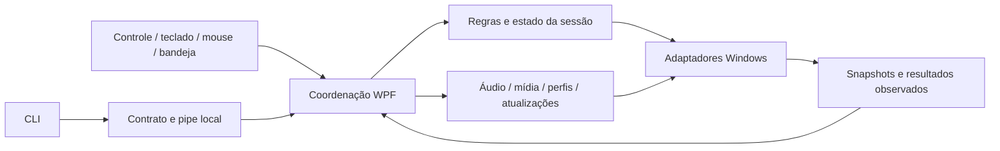

# Arquitetura

O processo mantém uma janela WPF oculta e um ícone de bandeja. `Program` inicializa Velopack, a instância única e a automação; `MainWindow.xaml.cs` compõe os serviços e conecta eventos por etapas nomeadas. A entrada por Guide e a bandeja usam o mesmo fluxo de abertura.

## Mapa do código

| Diretório em `src/ApolloOverlay` | Responsabilidade |
| --- | --- |
| `Domain` | Identidade de janelas, monitores e resultados de ações. |
| `Input` | XInput/Guide, interpretação, propriedade da entrada, soltura, metadados e apresentação factual da bateria. |
| `Windows` | APIs Win32, observação de janelas, foco, extração de ícones e captura de pixels. |
| `Audio` | Snapshots e comandos de áudio; contratos, backend Core Audio e declarações COM ficam separados. |
| `Session` | Referência da sessão, recentes, perfis, mídia, capturas e inserção deliberada de texto. |
| `Feedback` | Sons, vibração, prioridade e ciclo de vida dos sinais. |
| `Settings` | Leitura, validação, migração de ajustes e inicialização no Windows. |
| `Updates` | Identidade do build, fonte Velopack, canais e histórico de retorno. |
| `Automation` | Protocolo, transporte por pipe, permissões e registro de solicitações. A CLI compartilha apenas protocolo e segurança do transporte. |
| `Integrations` | Evidências e permissões específicas de integrações externas. |
| `UI` | Navegação, componentes, páginas e coordenação WPF. Os arquivos parciais da janela agrupam responsabilidades da mesma instância, sem fingir isolamento entre elas. |
| `Diagnostics` | Logs locais, prévias e provas limitadas a janelas próprias. |

Os namespaces públicos permanecem estáveis para preservar consumidores e fixtures. Os diretórios organizam responsabilidades; não representam serviços distribuídos nem impõem um contêiner de injeção.

## Estado e ações

`OverlayController` mantém ajustes, sessão, janelas recentes e resultados. `OverlayViewState` mantém rota, seleção e posição de rolagem. `InputCoordinator` interpreta os quatro slots XInput; `ReleaseGate` e `HeldInputTracker` tratam soltura e amostras incertas sem conhecer WPF. `ControllerBadgeModel` decide o que pode ser mostrado sem acessar hardware ou controles visuais.

Uma ação da interface verifica foco e disponibilidade, aguarda soltura contínua, valida o alvo novamente e só então chama o serviço. `ActionResult` distingue solicitação, conclusão observada, resultado parcial e estado desconhecido. Cancelar após um envio interrompe as etapas restantes; não desfaz um comando já aceito pelo Windows.

Uma identidade de janela contém HWND, PID, início do processo e geração observada. Títulos não estabelecem identidade. Leituras assíncronas carregam uma geração; a interface descarta conclusões de uma sessão, rota ou ciclo de foco anterior. Atualizações de valores preservam controles em edição; alterações na estrutura da página podem reconstruir suas linhas.

## Concorrência e recursos

- A janela, seleção e árvore visual pertencem ao dispatcher. Eventos de workers são transferidos para ele antes de alterar a interface.
- Áudio e mídia têm proprietários limitados. Um timeout não libera a exclusão enquanto uma chamada nativa ainda pode concluir. Não há repetição automática de uma mutação incerta.
- `WindowIconCache` limita capacidade e concorrência. `WindowIconReader` copia o HICON emprestado, cria uma imagem congelada e libera somente sua cópia. A conclusão atualiza a imagem sem substituir a linha ou seu foco.
- A recuperação de foreground usa uma thread auxiliar limitada, sem anexar a fila WPF à fila de outro processo. O resultado nativo não substitui a observação de foreground e atividade.
- Ocultar ou encerrar suspende mídia, leituras, feedback e animações. O encerramento drena operações que ainda podem possuir teclas ou recursos; conclusões antigas não reabrem o painel.

Os `catch` amplos restantes ficam em fronteiras que precisam preservar limpeza ou impedir que um callback externo derrube o proprietário. No fluxo comum, exceções esperadas são filtradas e convertidas em resultado ou indisponibilidade. Falhas de consulta não devem produzir valores inventados.

## Interface e compatibilidade

`ActionButtonContent` expõe título, descrição, ícone e área de edição sem depender da ordem dos filhos. `VectorIcon` preserva o quadro original de cada SVG: uma engrenagem não é redimensionada pelo limite irregular de seu path. Cores usam recursos do tema e vetores não recebem stroke adicional sobre um desenho já preenchido.

Os campos antigos de ajustes continuam sendo lidos para compatibilidade de dados; atalhos antigos não são reativados por isso. Nomes de assembly e executável permanecem por compatibilidade com instalação, inicialização e CLI. As ferramentas de prova não mantêm cópias independentes de código do aplicativo: os poucos contratos nativos necessários são vinculados explicitamente e compilados na solução.

Foco não isola XInput de outros processos. O controle visto no streaming pode ser virtual e não expor bateria. Essas limitações permanecem visíveis no produto e em [isolamento do controle](controller-isolation.md); não são tratadas como sucesso por fixtures.
