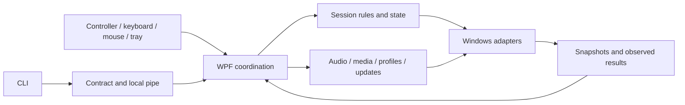

# Architecture

The process maintains a hidden WPF window and a tray icon. `Program` initializes Velopack, the single instance and automation. `MainWindow.xaml.cs` composes services and wires events through named stages. Guide and tray input use the same opening flow.

## Code map

| Directory in `src/ApolloOverlay` | Responsibility |
| --- | --- |
| `Domain` | Window and monitor identity, action results. |
| `Input` | XInput/Guide, interpretation, input ownership, release, metadata and factual battery presentation. |
| `Windows` | Win32 APIs, window observation, focus, icon extraction and pixel capture. |
| `Audio` | Audio snapshots and commands, with contracts, the Core Audio backend and COM declarations kept separate. |
| `Session` | Session reference, recent windows, profiles, media, captures and deliberate text insertion. |
| `Feedback` | Sound, vibration, cue priority and lifecycle. |
| `Settings` | Settings loading, validation, migration and Windows startup. |
| `Updates` | Build identity, the Velopack source, channels and rollback history. |
| `Automation` | Protocol, pipe transport, permissions and request records. The CLI shares only the protocol and transport security. |
| `Integrations` | Evidence and permissions specific to external integrations. |
| `UI` | WPF navigation, components, pages and coordination. Window partials group responsibilities of the same instance; they are not isolated services. |
| `Diagnostics` | Local logs, previews and proofs limited to owned windows. |

Public namespaces remain stable to preserve consumers and fixtures. Directories organize responsibilities; they do not represent distributed services or require a dependency-injection container.

## State and actions

`OverlayController` owns settings, the session, recent windows and results. `OverlayViewState` owns the route, selection and scroll position. `InputCoordinator` interprets the four XInput slots. `ReleaseGate` and `HeldInputTracker` handle release and uncertain samples without knowing WPF. `ControllerBadgeModel` determines what can be displayed without accessing hardware or visual controls.

A UI action checks focus and availability, waits for continuous input release, validates the target again and then calls the service. `ActionResult` distinguishes a request, observed completion, partial results and unknown outcomes. Cancellation after dispatch stops remaining steps; it does not undo a command Windows already accepted.

Window identity includes HWND, PID, process start time and observed generation. Titles do not establish identity. Asynchronous reads carry a generation; the interface rejects completion from an earlier session, route or focus cycle. Value updates preserve controls being edited. Changes to page structure may rebuild its rows.

## Concurrency and resources

- The dispatcher owns the window, selection and visual tree. Worker events move to it before changing the interface.
- Audio and media have bounded owners. A timeout does not release exclusion while a native call can still complete. Uncertain mutations are not retried automatically.
- `WindowIconCache` bounds capacity and concurrency. `WindowIconReader` copies the borrowed HICON, creates a frozen image and releases only its copy. Completion updates the image without replacing the row or its focus.
- Foreground recovery runs in an authenticated disposable child with a bounded deadline and a kill-on-close job. It does not attach the WPF queue to another process. Native return values do not replace observation of the exact foreground window and WPF activation.
- Hiding or shutting down suspends media, reads, feedback and animations. Shutdown drains operations that may still own keys or resources. Old completions cannot reopen the panel.

Broad `catch` blocks remain at boundaries that must preserve cleanup or stop an external callback from crashing its owner. Ordinary flows filter expected exceptions and convert them to results or unavailable states. A failed query must not produce invented values.

## Interface and compatibility

`ActionButtonContent` exposes its title, description, icon and editing area without relying on child order. `VectorIcon` preserves each SVG's original frame; a gear is not scaled to its irregular path bounds. Colors use theme resources, and filled vectors receive no extra stroke.

Legacy settings fields remain readable for data compatibility; this does not reactivate legacy shortcuts. Assembly and executable names remain stable for installation, startup and CLI compatibility. Proof tools do not maintain separate copies of application code. Their few required native contracts are linked explicitly and built with the solution.

Focus does not isolate XInput from other processes. A streaming controller may be virtual and expose no battery information. These limits stay visible in the product and in [controller isolation](controller-isolation.md). Fixtures do not treat them as confirmed success.

## Command diagnostics ownership

`Diagnostics/CommandLog` owns the bounded Serilog pipeline and operation evidence. `LocalDiagnostics` lazily owns that journal alongside settings paths. A controller disposes diagnostics only when it created them; the application entry point owns an explicitly shared instance until WPF exits. Fatal observation records failures without swallowing exceptions or changing termination policy.

`MainWindow.CommandDiagnostics` supplies safe semantic IDs and captures invocation source/correlation across dispatcher callbacks and deferred input release. Actual effect runners record terminal results before UI-generation guards. The automation host mirrors requests without weakening its separate durable safety ledger. The offline CLI reader has independent read/output bounds and no runtime or writer dependency. See [diagnostics](diagnostics.md).
